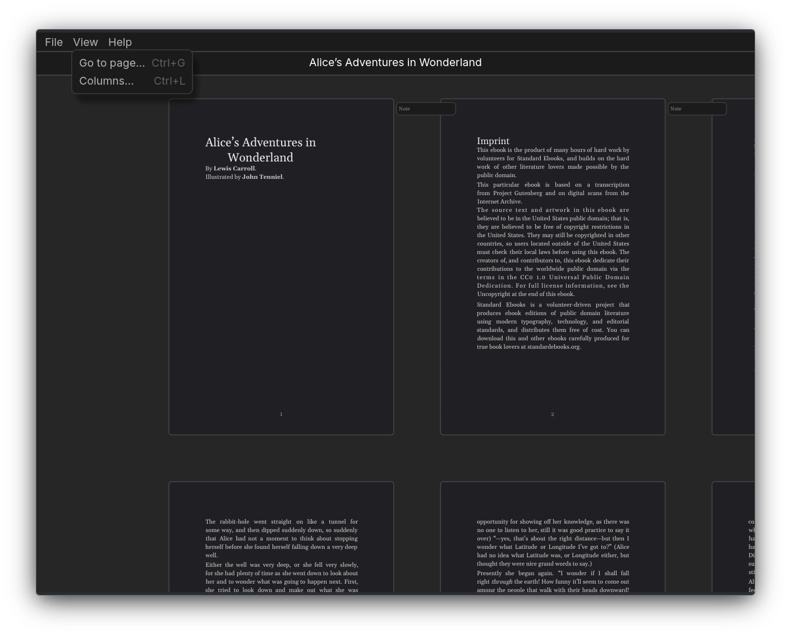

# pagething
A infinite canvas EPUB reader

## Features
- Pages spread in an infinite canvas

## Download
[Latest release](https://github.com/plucafs/pagething/releases)

## Credits
- [OpenCode](https://github.com/anomalyco/opencode)

## License
MIT
